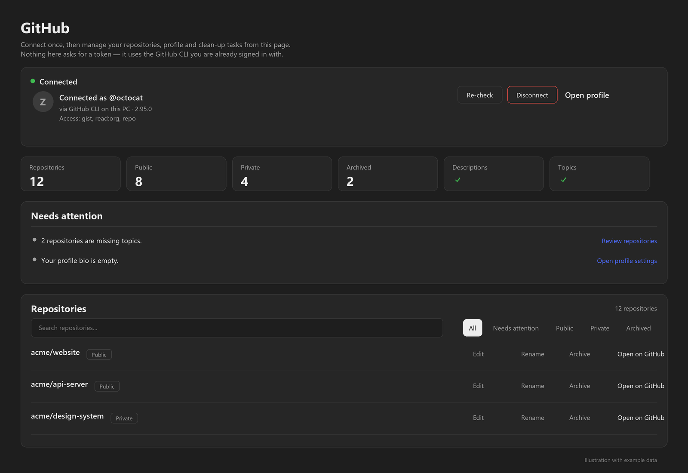

# GitHub panel for DeepSeek Harness

Manage the GitHub account that is already signed in on your PC — from inside DeepSeek Harness. The panel runs the GitHub CLI (`gh`) for you and shows the result on one page. **No token to paste, no API key, no extra sign-in.**

[](LICENSE)
[](https://github.com/zayyehtut/dsh-github-panel/releases)
[](https://github.com/deepseek-ai/deepseek-harness)



<sub>*Illustrated preview with example data — not a live account.*</sub>

## What you get

- **Your connection, at a glance** — connected as `@you`, via the GitHub CLI, with the token scopes GitHub reports.
- **Your repositories, counted** — total, public, private, archived, descriptions and topics coverage.
- **A "needs attention" list** — missing descriptions or topics, empty repositories, forks you no longer use, profile README, empty bio, unused pins, duplicate gists.
- **A searchable repository list** — edit a description or topics inline, archive or unarchive, rename, or open a repository on GitHub.
- **Profile & pins** — what the GitHub API can and cannot change, with links to the right GitHub settings pages.
- **A health report** — README, license, `.gitignore`, CI, tests and possible-secret checks per repository, with safe fixes you can apply in one click.

## Install

### Option 1 — DeepSeek Harness app (easiest)

1. Open **Plugins** in the left sidebar.
2. Click **Add plugin**, paste this into the package field:

   ```
   github:zayyehtut/dsh-github-panel
   ```

3. Click **Install**, then click **Enable now**.
4. Reload the window if the **GitHub** icon does not appear immediately.

### Option 2 — `dsh web` (command line)

```sh
dsh plugin --profile web add github:zayyehtut/dsh-github-panel
```

Restart `dsh web` afterwards. Replace `web` with your profile name if you use a custom one.

> Using the DeepSeek Harness desktop app? Use Option 1. The desktop app manages its own profile, so a CLI install into `profiles/web` will not show up there.

### Option 3 — dsh-market

The plugin is submitted to the community **dsh-market** catalog. Once it appears there, you can search for **GitHub panel** and install it with one click.

<details>
<summary><b>Manual profile setup (for development)</b></summary>

1. Clone the repository anywhere on the machine:

   ```sh
   git clone https://github.com/zayyehtut/dsh-github-panel.git
   ```

2. In your DSH profile's `package.json`, add the package as a linked dependency and to the bundle list:

   ```json
   {
     "dependencies": {
       "dsh-github-panel": "link:/absolute/path/to/dsh-github-panel"
     },
     "dsh": {
       "profile": {
         "bundles": [
           "@deepseek-ai/dsh-base",
           "@deepseek-ai/dsh-web-app",
           "dsh-github-panel"
         ]
       }
     }
   }
   ```

3. Let the profile install its dependencies (`pnpm install` in the profile folder, or let the Harness plugin manager do it).
4. Reload the Harness window.

</details>

## Before you start

| Requirement | Check |
|---|---|
| DeepSeek Harness **0.2.1 or newer** (tested on `0.2.1-rc.5`) | `dsh --version` or the About dialog |
| GitHub CLI installed | `gh --version` — install from [cli.github.com](https://cli.github.com/) |
| Signed in to GitHub through the CLI | `gh auth status` |

If `gh` is not installed or not signed in, the panel tells you what to do instead of failing silently.

## First run

1. Click the **GitHub** icon in the left rail (next to *Plugins* and *Automation tasks*).
2. The panel shows **Connected as @you** and your repository counts.
3. If it says the account is not connected: run `gh auth login` in a terminal, then press **Re-check**.
4. Use the filters above the repository list to narrow down what you want to fix, and the **Needs attention** list to start.

## Safety and privacy

- The panel is served by your own Harness process on `127.0.0.1` only.
- Every change re-reads the repository from GitHub first and needs admin rights on it; descriptions and topics are validated again before writing.
- The panel **never reads the token**. It only launches `gh`, which holds the login in your OS keyring.
- Nothing is written to disk by the panel; the action log is in memory and disappears when the Harness restarts.
- Repository deletion is not offered. Pins and profile name/bio are linked out to GitHub because the API has no write access for them.

## Troubleshooting

| Symptom | Fix |
|---|---|
| The **GitHub** icon is missing | Confirm the bundle is enabled on the Plugins page, reload the window, and check that your DSH is 0.2.1 or newer. |
| "Not connected on this PC" | Run `gh auth login`, confirm with `gh auth status`, then press **Re-check**. |
| The panel shows the wrong account | Run `gh auth switch` (or `gh auth login` for the right account), then press **Re-check**. |
| "Loading your GitHub account..." never finishes | Check the network (GitHub API reachability) and that `gh api user` works in a terminal. |
| `gh` is not found in a sandboxed host | Set `DSH_GITHUB_CONFIG_DIR` to the directory holding the `gh` config, or make sure `gh` on `PATH` belongs to the user running the Harness. |
| A change fails with "permission" | The token needs the `repo` scope and you need admin rights on that repository. |

## Compatibility

- **DeepSeek Harness:** 0.2.1 or newer; developed and tested against `0.2.1-rc.5`.
- **Platforms:** Windows 10/11 tested. macOS and Linux use `gh` from `PATH` and are untested.
- **GitHub CLI:** 2.x; tested with 2.95.0.

## Development

There is no build step: the bundle is plain ESM JavaScript.

```
index.js          Host half — loopback HTTP routes, runs gh, never touches the token
client.js         Client half — the rail icon and the panel UI
cordis.patch.yml  The DSH bundle patch that inserts the plugin row
locale/           Display metadata (English, Chinese)
assets/           The icon and the generated preview illustration
screenshots.json  Declares the preview for marketplace cards
tools/            Generator for the illustrated preview
```

The preview image is generated, not captured: `python tools/make-preview.py` redraws it from code (requires Pillow). It contains example data only and carries an "Illustration with example data" note.

Clone the repo, link it into a DSH profile as shown under *Manual profile setup*, and reload. Changes to `client.js` need a window reload; changes to `index.js` need the plugin to be re-enabled.

Issues and pull requests are welcome.

## License

MIT — see [LICENSE](LICENSE).

[](https://github.com/deepseek-ai/deepseek-harness)
